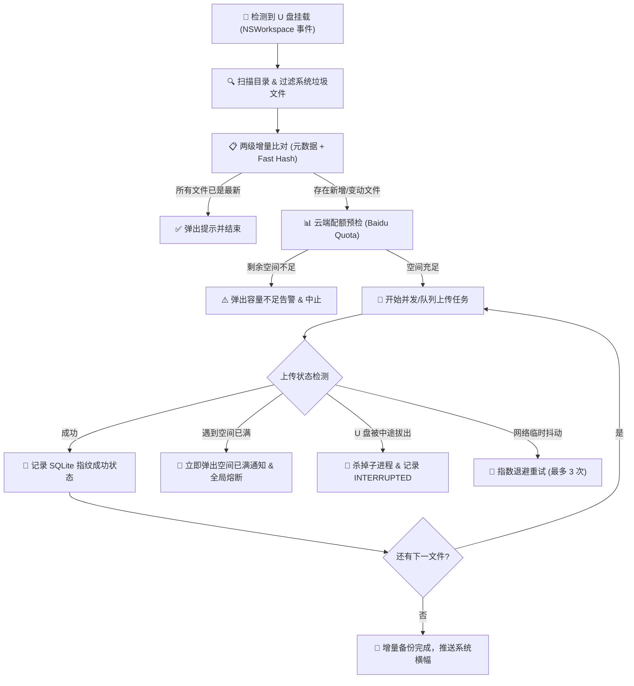

# 💾 USBBaiduSync

> **专为 macOS 设计的免人工干预 U 盘自动增量备份至百度网盘工具**  
> 插上 U 盘，后台静默感知、秒级增量去重、直接同步到百度云端指定日期目录。完全独立自包含，拔出即刻安全终止。

[](https://www.apple.com/macos/)
[](https://github.com/oneideals/usb-baidu-sync)
[](https://www.python.org/)
[](LICENSE)
[](https://github.com/oneideals/usb-baidu-sync/actions/workflows/ci.yml)

---

## 💡 为什么需要 USBBaiduSync？

摄影师、视频创作者、办公人员经常需要将相机卡、移动硬盘或 U 盘里的照片/资料归档到百度网盘。传统操作通常需要：
1. 插入 U 盘 -> 手动打开访达；
2. 打开百度网盘客户端 -> 手动新建文件夹并拖拽；
3. 如果上次传过一部分，还得肉眼比对哪些传过、哪些没传过；
4. 传输途中如果手快误拔 U 盘，很容易导致网盘产生残缺坏文件。

**USBBaiduSync** 让这一切完全自动化：**只要把 U 盘插上 Mac，它就在后台自动完成比对和增量上传；拔出 U 盘自动熔断保护。**

---

## ✨ 核心特性

- 🔌 **即插即检（零轮询感知）**  
  基于 macOS Cocoa 原生 `NSWorkspace` 挂载事件通知，无死循环扫描，0% 静默 CPU 占用，毫秒级响应 U 盘插入与拔出。
- ⚡ **两级智能增量判定（秒级去重）**  
  - **一级比对**：秒级比对 `(相对路径, 文件大小, 修改时间)` 元数据，未修改文件 0 毫秒跳过。
  - **二级比对**：首中尾 1MB 切片 Fast Hash 校验，精准识别文件内容变更，杜绝假修改与重复流量。
- 📦 **开箱即用独立打包（无需配置环境）**  
  提供完全自包含的独立二进制 `USBBaiduSync.app`，内置支持 Apple Silicon (M1-M4) 与 Intel 的 **Universal 2 BaiduPCS-Go** 工具，**无需安装 Python、无需 Homebrew**，解压即用。
- 🛡️ **云端容量预检与空间已满智能熔断**  
  - **前置预检**：同步前调用接口计算网盘可用配额，若待传容量超出剩余空间，提前告警拦截；
  - **实时熔断**：传输中一旦捕获容量超限（如 `31061`、`空间不足`），立即推送系统警告横幅并**全局熔断终止**，不再进行无意义的重复重试。
- 🧯 **即拔即停与断点接续**  
  传输中途拔出 U 盘，底层上传子进程立即安全杀死，数据库精准记录 `INTERRUPTED` 中断状态；下次插入时自动无缝接续，不留僵尸进程。
- 🧹 **macOS 系统垃圾自动过滤**  
  默认过滤 `.DS_Store`、`._*` 资源分叉文件、`.Spotlight-V100`、`.Trashes`、`$RECYCLE.BIN` 等无用系统垃圾。
- 📅 **智能按日归档组织**  
  在网盘目标目录下按 `YYYY-MM-DD_<U盘名称>/` 自动归档；改天再次插入时，已备份文件秒级跳过，当天新增文件自动归档至当天目录。
- 🖥️ **原生菜单栏体验**  
  常驻屏幕右上角状态栏（`💾` / `🔄` / `⚠️`），不占 Dock 栏；上传开始、完成、中断、登录过期均推送原生通知横幅。

---

## 🔄 同步与调度流程



---

## 🚀 下载与安装

### 方式一：下载预编译独立 App（最推荐）

1. 前往 [Releases](https://github.com/oneideals/usb-baidu-sync/releases) 页面下载最新的 **`USBBaiduSync.zip`**。
2. 解压后将 **`USBBaiduSync.app`** 拖入系统的 **“访达 -> 应用程序” (Applications)** 目录。
3. **首次启动提示解决**（由于网络下载应用 macOS Gatekeeper 会做安全隔离）：
   * **方法 1（推荐）**：在 `USBBaiduSync.app` 图标上**点击鼠标右键**，选择 **“打开”**，在弹窗中点击 **“打开”** 即可。
   * **方法 2**：打开“终端”，运行以下命令解除隔离属性：
     ```bash
     xattr -cr /Applications/USBBaiduSync.app
     ```
4. 启动后，屏幕右上角菜单栏将常驻 `💾` 小图标。

---

### 方式二：开机自动启动（真正免干预）

如果希望每次开机自动常驻后台、插上 U 盘即刻自动备份：
```bash
./scripts/install_autostart.sh
```
* 如需取消开机自启，随时运行 `./scripts/uninstall_autostart.sh` 即可。

---

### 方式三：源码运行（开发者与高级用户）

1. **克隆项目**：
   ```bash
   git clone https://github.com/oneideals/usb-baidu-sync.git
   cd usb-baidu-sync
   ```

2. **准备 Python 虚拟环境**：
   ```bash
   python3 -m venv .venv
   source .venv/bin/activate
   pip install -r requirements.txt
   ```

3. **运行**：
   * **模拟运行测试（Dry-Run 模式，不实际上传）：**
     ```bash
     python3 run.py --dry-run -v
     ```
   * **正式启动：**
     ```bash
     python3 run.py
     ```

4. **重新打包独立可分发 App**：
   ```bash
   ./scripts/create_app.sh
   ```

---

## ⚙️ 首次配置说明（仅需 1 分钟）

本软件无需官方百度网盘客户端常驻，只需获取一次账号凭证 **BDUSS** 即可直接调用百度 PCS 云端接口：

1. 用浏览器（Chrome、Edge 或 Safari）登录百度网盘网页版 [pan.baidu.com](https://pan.baidu.com)。
2. 按 `F12`（或右键“检查”）打开开发者工具，进入 **Application (应用) -> Storage -> Cookies -> `https://pan.baidu.com`**。
3. 在 Cookie 列表中找到名称为 **`BDUSS`** 的条目，复制其 **Value**（一串长字符串）。
4. 点击 Mac 屏幕右上角菜单栏的 `💾` 图标，选择 **「🔑 设置百度网盘凭证 (BDUSS)...」** 粘贴并保存。
   * 绑定成功后，软件会自动查询并弹窗提示当前网盘已用与总空间容量！
5. （可选）点击 **「📂 百度网盘目标目录...」** 自定义云端备份存放路径（默认：`/自动备份/USB`）。

---

## ❓ 常见问题 (FAQ)

#### Q1: 如果百度网盘官方客户端没有开启，能否上传？
**A: 可以，完全不影响。**  
USBBaiduSync 底层内置了独立的 Universal 2 `BaiduPCS-Go` 引擎，直接与百度 PCS 云端 API 建立安全加密通信，不依赖、不调用官方“百度网盘.app”。无论官方客户端开启、退出还是完全未安装，都不影响本工具上传。

#### Q2: 如果网盘空间已满，软件会怎么处理？
**A: 具有双重防护机制：**  
1. **同步前预检**：在开始上传前比对当前网盘可用配额，若待传文件总大小超出剩余容量，直接提前告警拦截；
2. **实时错误熔断**：若传输中云端报错空间已满，软件会立刻弹出系统通知警告并全局熔断退出，不会对后续文件进行无意义的反复重试。

#### Q3: 百度网盘单文件限制是多少？
**A:**  
* 百度网盘对免费普通账号限制单文件大小为 **4GB**（白金会员 10GB，SVIP 20GB）。
* 当 U 盘内有超过 4GB 的单文件且账号非 VIP 时，软件会在日志与状态中给出大文件预警提示。

#### Q4: 本地数据与日志保存在哪里？
* **配置文件**：`~/Library/Application Support/USBBaiduSync/config.json`
* **指纹数据库**：`~/Library/Application Support/USBBaiduSync/sync_records.db`
* 可在菜单栏直接点击 **「📜 打开数据与日志目录」** 快速在访达中打开查看。

---

## 🛠️ 技术栈与依赖

* **UI 框架**：macOS Cocoa / [`rumps`](https://github.com/jaredks/rumps) / [`pyobjc`](https://github.com/ronaldoussoren/pyobjc)
* **事件监听**：`NSWorkspaceDidMountNotification` / `NSWorkspaceDidUnmountNotification`
* **传输引擎**：[`BaiduPCS-Go`](https://github.com/qjfoidnh/BaiduPCS-Go) (Go 编写的百度网盘命令行工具，已封装内置)
* **状态持久化**：SQLite3 WAL 模式
* **构建打包**：PyInstaller + Universal 2 Mach-O Binary Lipo

---

## 🤝 参与贡献

欢迎提交 Issue 或 Pull Request！详细指引请阅读 [CONTRIBUTING.md](CONTRIBUTING.md)。

1. Fork 本项目
2. 创建特性分支 (`git checkout -b feat/amazing-feature`)
3. 提交代码 (`git commit -m 'feat: Add some amazing feature'`)
4. 推送分支 (`git push origin feat/amazing-feature`)
5. 新建 Pull Request

---

## 📄 开源许可证

本项目基于 [MIT 许可证](LICENSE) 开源发布。可自由用于个人、商业或二次分发。
